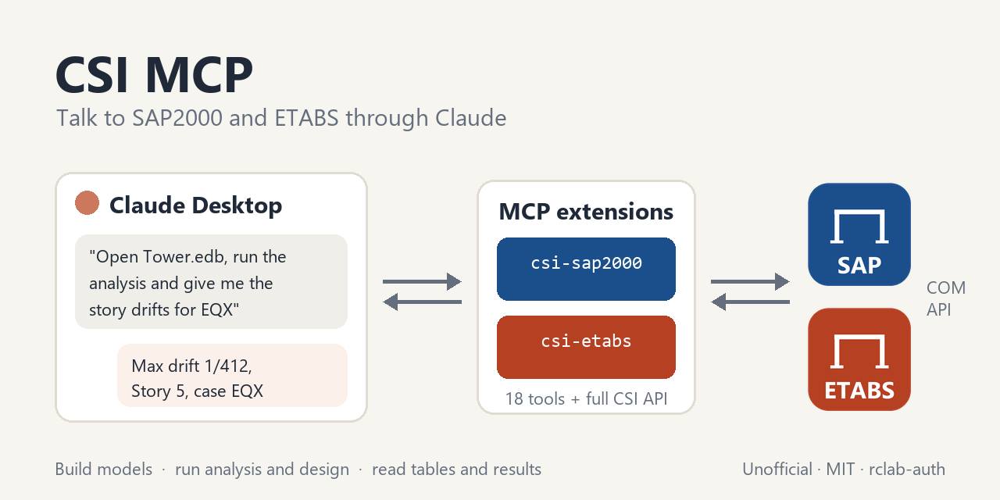

# CSI MCP : Claude for SAP2000 and ETABS



Two Claude Desktop extensions that let Claude work directly with **SAP2000** and **ETABS** through their official COM API. You talk to Claude in plain language, and it builds or edits the model, runs the analysis and design, and reads tables and results in the program that is open on your computer.

> **Unofficial.** This project is not affiliated with, endorsed by or supported by Computers and Structures, Inc. (CSI). SAP2000 and ETABS are registered trademarks of CSI.

## Supported versions

| Extension | Program | Tested | Expected to work | Not supported |
|---|---|---|---|---|
| `csi-sap2000` | SAP2000 | **v26.2.0** (API 2.006) | v23.0 and later | v22 and older |
| `csi-etabs` | ETABS | **v22.3.0** and **v23.2.0** (API 2.004 and 2.014) | v18.0 and later | v17 and older |

- **Tested :** the CSI verification examples of the [Verification](#verification) section passed on these versions :
  - **SAP2000 26.2.0 :** all four SAP2000 examples.
  - **ETABS 23.2.0 :** all four ETABS examples.
  - **ETABS 22.3.0 :** Example 1-001 only, because this version was replaced by v23 before the other examples were added.
- **Expected to work :** these versions have everything the extension relies on, but have not been tested yet. Reports are welcome as GitHub issues.
  - **SAP2000 :** the database tables API, on which most tools rest, exists since SAP2000 v23.0.0. Attaching to a specific window by process ID needs v24.1.0 or later; attaching to the active window works on all supported versions.
  - **ETABS :** the `ETABSv1` API library and the database tables exist since ETABS v18.0.
- **Not supported :** older versions lack the database tables API; ETABS v17 and older also used a different API library (`ETABSv17`).
- **Newer versions :** future versions should work, as CSI keeps the API backward compatible. The extension picks up their new functions by itself after an upgrade (see Good to know).
- **Functions of newer versions :** some functions exist only in newer versions, e.g. concrete shell design and section cuts in ETABS v23. Calling them on an older version returns an error, without harm.

## What Claude can do with it

- **Connect :** attach to the SAP2000/ETABS window you already have open, or start a new instance.
- **Build or edit models :** materials, sections, frames, areas, restraints, load patterns, loads, combinations, and anything else the CSI API offers.
- **Analysis and design :**
  - run the analysis, all or selected load cases
  - start design with the code and preferences already set in the model :
    - **SAP2000 :** concrete, steel, cold-formed steel and aluminum frames
    - **ETABS :** concrete and steel frames, composite beams and columns, concrete slabs, and concrete shells (v23 and later)
- **Database tables :**
  - read any of them (input, analysis results, design results)
  - edit importable tables and apply them back to the model, with the full import log
- **Results :** joint displacements and reactions, frame forces, base reactions, modal periods and mass ratios, story drifts, pier and spandrel forces.
- **Whole-API access :** a generic `call_api` tool reaches every function of the API (about 2000 in SAP2000, 1300 in ETABS). Claude looks up the documentation of each function in the API help file of your own installation before calling it.

Example requests :

- *"Open my model C:\Projects\Tower.edb, run the analysis and give me the story drifts for EQX and EQY."*
- *"Change the depth of section B30x60 to 70 cm, rerun, and compare the maximum beam moments before and after."*
- *"Build a 3-story, 2×2 bay R/C frame with 5 m spans and 3 m stories, add dead and live loads on the slabs, and check the columns with Eurocode 2."*

## Requirements

- **Windows** : the CSI API is COM based.
- **A licensed installation** of SAP2000 and/or ETABS in a version listed under Supported versions, in the default folder `C:\Program Files\Computers and Structures`. If several versions are installed side by side, the newest is used automatically.
- **[Claude Desktop](https://claude.ai/download)**, recent version.
- **[uv](https://docs.astral.sh/uv/)** : Claude Desktop uses it to install the Python dependencies of the extension. If Claude reports that uv is missing, install it with `winget install astral-sh.uv`.

No Python setup is needed : the dependencies (`mcp`, `comtypes`) are installed automatically. CSI files are not redistributed; the extension uses the type library and help file of your own installation.

## Installation

1. Download `csi-sap2000-x.y.z.mcpb` and/or `csi-etabs-x.y.z.mcpb` from the [latest release](https://github.com/rclab-auth/csi-mcp/releases/latest).
2. Install it in Claude Desktop, in either of two ways :
   - Double-click the file, if `.mcpb` files are associated with Claude Desktop.
   - Otherwise (common on Windows, e.g. with the Microsoft Store edition) : open **Settings → Extensions → Advanced settings → Install Extension…** and choose the file, or drag the file onto the Extensions page.
   
   Claude Desktop then shows **Install**.
3. Start a new chat and ask, for example, *"Connect to ETABS and tell me the stories of the open model."*

To remove an extension : Claude Desktop → Settings → Extensions.

## Tools

| Tool | Purpose |
|---|---|
| `connect`, `disconnect`, `status` | Attach to or start the program, release it, show version, model file, units and lock state |
| `open_model`, `new_blank_model`, `save_model`, `set_units` | Model files and units |
| `run_analysis`, `run_design` | Analysis (all or selected cases) and design runs |
| `list_tables`, `table_fields`, `get_table`, `edit_table` | Interactive database tables : list, read, edit and apply |
| `get_results` | Any `Results` function, one row per result |
| `call_api` | Any function of the API by dotted path, e.g. `FrameObj.AddByCoord` |
| `search_api`, `api_doc` | Search and read the API help of your installation |
| `stories` | ETABS only : story names, elevations and heights |

Large tables are written to a CSV file in the temporary folder, and Claude gets the path plus the first rows.

## Good to know

- **Saving :**
  - The model must be saved before an analysis.
  - `save_model` always needs an explicit path.
  - Closing the program (`disconnect` with `close_app`) is allowed only for an instance the extension started itself; a window you opened is never closed.
- **Locked models :** after an analysis the model is locked, as in the GUI. Before editing it, Claude unlocks it (`SetModelIsLocked`), which deletes the analysis results.
- **Program upgrades :** after a SAP2000/ETABS upgrade, the extension notices the new version on its first start. It then regenerates its API wrapper and rebuilds its help index, which takes about a minute once.
- **Not available in the ETABS API :**
  - Starting shear wall design : run it in the GUI. Claude can then read the results.
  - Eurocode 8 auto-seismic loads and user response spectrum functions : define them through the database tables (`edit_table`), which Claude can do.
- **ETABS habits worth knowing** (details in [examples](examples/README.md#lessons-from-the-examples)) :
  - ETABS adds rigid end offsets automatically from the member depths.
  - Lateral masses are lumped at the story levels, so models need stories at the floors.
  - A new model already contains a diaphragm named `D1`.

## Verification

Seven CSI verification problems were rebuilt **from scratch** through the extension tools (no CSI model file opened), analyzed, and compared with the values published in the CSI verification manuals :

| Program | Example | Largest difference from the manual |
|---|---|---|
| SAP2000 | 1-001 Frame, general loading (7 load cases) | 0.02 % |
| SAP2000 | 1-007 End releases | exact |
| SAP2000 | 1-013 Beam on elastic foundation | 0.00 % |
| SAP2000 | 2-008 Cantilever plate eigenvalues (shells) | 0.09 % |
| ETABS | 1-001 Frame, general loading | 0.08 % |
| ETABS | Example 1 Plane frame, gravity loads | 0.03 % |
| ETABS | Example 6 Nine-story frame, eigenvalues | 0.00 % |
| ETABS | Example 8 Two-story 3D frame, response spectrum | 0.15 % |

- **[examples/](examples) :** one page per example, with a prompt you can paste into Claude to reproduce it.
- **[validation/](validation) :** the scripts that run the examples automatically, and the [full results](validation/RESULTS.md) (67 of 67 comparisons pass).

## Building from source

```
common/          shared code : COM layer, help index, MCP tools
SAP2000/         entry point, manifest.json, pyproject.toml, icon
ETABS/           entry point, manifest.json, pyproject.toml, icon
examples/        one page per verification example, with a prompt for Claude
validation/      scripts that run the examples through the tools, and the results
docs/            banner
build.ps1        builds dist/*.mcpb (needs Node.js for npx @anthropic-ai/mcpb)
```

```powershell
.\build.ps1             # both extensions
.\build.ps1 ETABS       # one extension
```

Self-test without starting the program :

```powershell
uv run --script SAP2000\src\sap2000_mcp.py --selftest
```

To run from source in Claude Desktop, add an entry to its configuration file. The easiest way to open it is **Settings → Developer → Edit config**, since its location differs between editions : `%APPDATA%\Claude\claude_desktop_config.json`, or under `%LOCALAPPDATA%\Packages\Claude_…\LocalCache\Roaming\Claude\` for the Microsoft Store edition. Don't keep a source entry and the installed extension at the same time, or the tools appear twice.

```json
"csi-etabs": {
  "command": "uv",
  "args": ["run", "--script", "C:\\path\\to\\csi-mcp\\ETABS\\src\\etabs_mcp.py"]
}
```

## License and author

MIT License. Developed by Vassilis K. Papanikolaou, Laboratory of Reinforced Concrete and Masonry Structures, School of Civil Engineering, Aristotle University of Thessaloniki.
